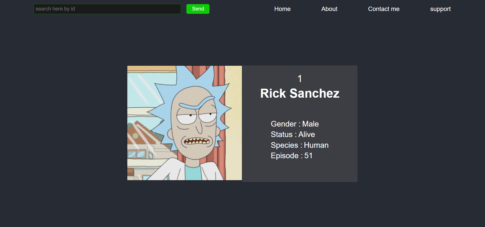

# Rick and Morty Character Explorer

This project was developed for learning purposes using the [Rick and Morty API](https://rickandmortyapi.com/). It allows users to explore characters from the Rick and Morty universe and view their information.

## Overview

The application is divided into two main sections:

### Navigation Bar
At the top of the page, you'll find a navigation bar featuring:
- **Search:** An input field that allows users to find any character by their ID.
- **Home:** Takes users to the main page.
- **About:** Provides information about the project.
- **Contact:** A section for contact information.
- **Support:** A dedicated support page.

### Character Information
Below the navigation bar, the application displays detailed information about the selected character, including their name, ID, image, gender, status, species, and number of episodes they appear in.

### Character List & Pagination
At the bottom of the page, you'll find a list of characters with pagination. Each page displays **20 characters**, allowing users to browse through the Rick and Morty universe and select a character to view their details.

